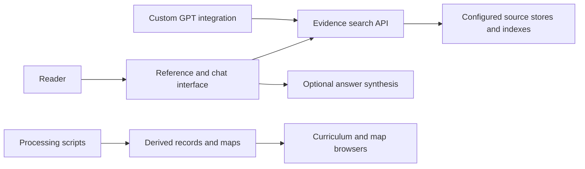

# Project guide

> October 10 update: the reviewed #51 maps and sharing fixes are consolidated in the canonical hub. [Current release record](HUB_RELEASE_20261010.md). The inventory below preserves the earlier snapshot; it is not a fresh count of open PRs.

This guide describes the repository checked on October 10, 2026. It separates the code available on the default branch from proposed additions and historical implementation records.

## How the pieces fit

This is an architectural overview, not evidence that every source is currently available or every hosted route is working.

## Choose the right component

| Component | Location | Role and status |
|---|---|---|
| Reference/chat app | [frontend/pathology_hub_chat_mvp](../frontend/pathology_hub_chat_mvp/) | Present on the default branch. Interface and server for retrieval, browsing and optional synthesis. |
| Recovered evidence backend | [backend/pathology_hub_v04_live_recovered](../backend/pathology_hub_v04_live_recovered/) | Recovered source with its own provenance notes. Do not infer deployment parity from the folder name. |
| Curriculum backend work | [backend/pathology_hub_v04_curriculum](../backend/pathology_hub_v04_curriculum/) | Separate curriculum API implementation; its dated runbooks describe version differences. |
| Curriculum provenance browser | [tools/curriculum_provenance_browser](../tools/curriculum_provenance_browser/) | Tool for inspecting curriculum mapping and provenance. |
| Custom GPT integration | [gpt_builder](../gpt_builder/) | Instructions and integration packages using the evidence API. |
| Unified teaching maps | [PR #51](https://github.com/herndoch/pathology-hub-dev/pull/51) | Pending addition, containing the lecture-map work from PR #50. |
| Source-processing utilities | [scripts](../scripts/) and [notebooks](../notebooks/) | Multiple dated workflows; inspect each workflow's inputs and outputs before running it. |
| Tests | [tests](../tests/) | Existing checks; test presence is not a current passing result. |
| Audit and delivery records | [audits](../audits/), [release_artifacts](../release_artifacts/), [project_sources](../project_sources/) | Historical evidence, retained with its original dates. |

The maintainer's current application workspace also contains later uncommitted changes. Those are not included in this documentation PR and require their own reviewed integration.

## Repository relationships

[This repository](https://github.com/herndoch/pathology-hub-dev) is the application/development entry point. The related [pathology_hub](https://github.com/herndoch/pathology_hub) repository documents the earlier pipeline for turning source material into structured records and teaching outputs. Keeping those roles explicit will help readers distinguish the application from its data preparation.

The [pathology_anki_deck](https://github.com/herndoch/pathology_anki_deck) repository is a separate named project. Its current README provides only its name, so its relationship and runnable deliverable still need review.

## Read documentation by purpose

1. Use the [root README](../README.md) for project orientation.
2. Use this guide to locate a component.
3. Use the component's README and tests to understand its current checked-in behavior.
4. Use the [consolidation plan](REPOSITORY_CLEANUP.md) for outstanding repository decisions.
5. Use dated runbooks and handoffs for provenance; confirm their commands and version assumptions before applying them.

For backend history, start with [recovered source notes](../backend/pathology_hub_v04_live_recovered/README_RECOVERED_SOURCE.md). The [July development runbook](LOCAL_DEV_WITH_CURSOR_CODEX_RUNBOOK_20260705.md) is useful historical context, but its local paths and production assumptions are not a current setup guarantee.

## Delivery boundaries

A usable software delivery needs a pinned code version, configuration instructions, representative test results, and a verified primary workflow. A research delivery also needs its stated methods, inputs, outputs, and limitations. These should be linked deliberately rather than treating every dated output as the latest release.

Source records, staged data, searchable indexes, and API-visible capabilities are different stages. A file's existence does not establish that it is indexed, accessible, or exposed through the application.
